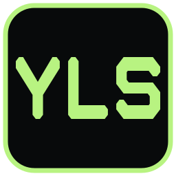

{: width="48" height="48" }

# Yumlog Studio

Yumlog records and analyzes media on Windows. A `.mdkg` sidecar can tie a
runbook step to a specific time and source value, so a client can verify the
step rather than trust a summary.

| What you want to build | Start here |
|---|---|
| A client that discovers native capabilities, reads evidence, or builds a widget | [SDK and framework guide](docs/SDK-FRAMEWORK.md) |
| An agent that uses stdio, stateless HTTP, or server-sent events | [Agent Plugin 1.0 and MCP wire guide](docs/AGENT-PLUGIN.md) |
| A recording or a cited runbook using the command line | [Native CLI reference](docs/NATIVE-CLI.md) |
| A local model that answers questions about a recording | [On-device reasoning](docs/ON-DEVICE-REASONING.md) |

[Source and installation](https://github.com/DarbotLM/yumlog#readme) ·
[Release downloads](https://github.com/DarbotLM/yumlog/releases)

This site serves documentation, not an MCP endpoint. Opening a guide does
not contact a local service, capture your screen, or send media anywhere.
